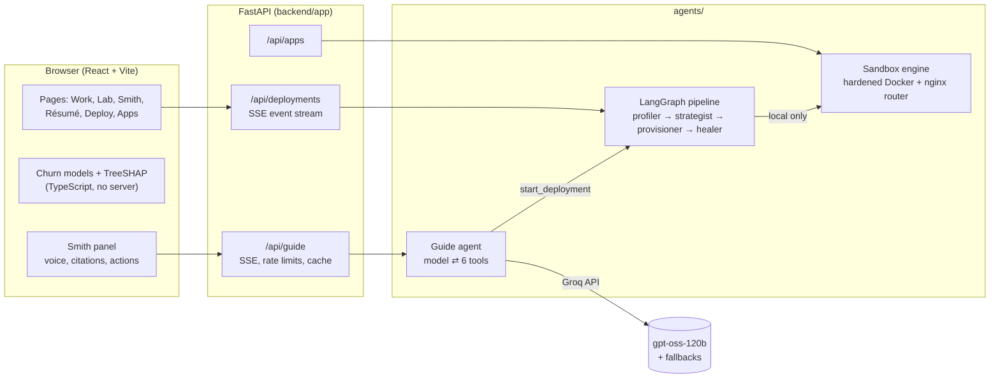

# DeploySmith OS

[](https://github.com/thechiragbatra/deploysmith/actions/workflows/ci.yml)

**Chirag Batra's portfolio, built as a working system.** It is a multi-agent deployment
platform, a live ML lab and an AI guide in one site, all running on free tiers.

| | What it is | Where |
| --- | --- | --- |
| **DeploySmith** | Four LangGraph agents profile any public GitHub repo, plan free-tier hosting, deploy it and self-heal, streaming every step. Locally, a hardened Docker sandbox runs real deploys with rollback. | `/deployer`, `/apps` |
| **Churn Uplift Lab** | The churn project's XGBoost and T-learner uplift models running in the browser, with exact TreeSHAP checked against XGBoost and an honestly graded uplift benchmark. | `/lab` |
| **Smith** | An AI agent that answers questions about the portfolio with citations and uses the site as its tools: opens pages, reads the screen, runs the churn model, profiles and deploys repos. Graded 27/28 on a golden eval set. | ⌘K anywhere, `/smith` |

## Contents

- [Architecture](#architecture)
- [Repository layout](#repository-layout)
- [Quick start](#quick-start)
- [Configuration](#configuration)
- [The deployment pipeline](#the-deployment-pipeline)
- [Smith, the AI guide](#smith-the-ai-guide)
- [Churn Uplift Lab](#churn-uplift-lab)
- [Testing](#testing)
- [Deployment](#deployment)
- [API](#api)
- [Ground rules](#ground-rules)

## Architecture



Every pipeline step and every Smith tool call streams to the browser as server-sent events.

## Repository layout

```text
agents/                 Python agents, imported by the backend
  base.py, models.py      Agent protocol and domain models (mirror shared/schemas)
  profiler.py … healer.py the four pipeline agents
  skills/                 clone, analyze, plan, probe, diagnose, github_url
  sandbox/                the local deployment engine (docker, recipes, store, router, engine)
  guide/                  Smith: agent loop, tools, search, churn port, LLM client, evals
backend/                FastAPI service
  app/main.py             middleware, routers, startup
  app/settings.py         .env loading, host and origin allowlists
  app/routers/            deployments, apps, guide
  app/services/           graph, runs, events, guide_store
  tests/                  api/, pipeline/, skills/, sandbox/, guide/
frontend/               React + TypeScript + Tailwind
  src/pages/              one file per route
  src/features/           deployer/, guide/, lab/, portfolio/
  src/components/         shared UI: layout/, ui/, fx/ (shader background, motion)
  src/lib/, src/hooks/    cross-cutting helpers
  src/data/               portfolio content (résumé, projects, published eval scores)
  public/models/          exported Churn Lab models
  tests/                  node:test suites (model parity, scoring, SSE, speech)
ml/churn/               trains and exports the Churn Lab models (uv project)
shared/schemas/         JSON Schemas: the source of truth for state and event types
deploy/
  docker/api.Dockerfile   the API image, used by every host
  azure/                  Container Apps + Static Web Apps (primary)
  gcp/                    Cloud Run alternative (nginx web image, Cloud Build)
.github/workflows/      CI, and publishing the API image to ghcr.io
```

## Quick start

Requirements: Node 22+, Python 3.11+ with [uv](https://docs.astral.sh/uv/). Optional: Docker
(real sandbox deploys) and a free [Groq key](https://console.groq.com/keys) (Smith).

```sh
cp .env.example .env             # optional; every value has a default. Add GROQ_API_KEY for Smith.

# API on :8000 (loads .env itself)
cd backend && uv sync
PYTHONPATH=.. uv run uvicorn app.main:app --reload --reload-dir . --reload-dir ../agents

# Site on :5173 (in a second terminal)
cd frontend && npm install && npm run dev
```

Real deploys on your machine: start Docker, then run the API with `SANDBOX_ENGINE=1`. Apps
are built in hardened containers and served at `http://<app>.localhost:8080`.

### Editing content

Portfolio content lives in `frontend/src/data/*.json`, which the site, the résumé PDF and Smith
all read. After editing `resume.json`, regenerate the downloadable PDF with
`cd frontend && npm run resume:pdf` (needs Google Chrome). In development, the Work page has an
**Add project** button that fills a project in from its GitHub URL.

## Configuration

All settings are environment variables, documented in [.env.example](.env.example). The
ones you are most likely to change:

| Variable | Default | Purpose |
| --- | --- | --- |
| `GROQ_API_KEY` | unset | Enables Smith. Without it the guide's button stays hidden |
| `GROQ_MODEL`, `GROQ_FALLBACK_MODELS` | `openai/gpt-oss-120b`, then `gpt-oss-20b`, `qwen3.8-27b` | Model order when a free quota runs out |
| `SANDBOX_ENGINE` | `0` | `1` = real deploys in local Docker; otherwise the deploy step is simulated |
| `MOCK_AGENTS` | `0` | `1` = fully offline mock agents |
| `GUIDE_RATE_PER_HOUR`, `GUIDE_DAILY_LIMIT` | `30`, `150` | Per-visitor and site-wide question limits |
| `CORS_ORIGINS`, `ALLOWED_HOSTS` | localhost | Set to your hostnames when hosting |
| `VITE_API_URL` | `http://localhost:8000` | Where the site finds the API (build time) |

## The deployment pipeline

```text
profiler → strategist → provisioner → healer ─┐
                             ▲                │ unhealthy and repairs < 3
                             └────────────────┘
```

- **Profiler** (`agents/skills/clone.py`, `analyze.py`): a hardened `git clone --depth 1`:
  HTTPS only, no submodules, LFS or hooks, symlinks checked out as plain files, host git
  config ignored, 60 s timeout, 200 MB cap. Analysis only reads files; nothing from the repo
  is executed.
- **Strategist** (`agents/skills/plan.py`): deterministic rules map each component to a free
  tier: Vite → Vercel, FastAPI → Render, Streamlit → Hugging Face Spaces, Postgres → Neon.
  Engines with no free target are reported, never placed on a paid host.
- **Provisioner**: deploys each component; with the sandbox engine on, for real.
- **Healer** (`agents/skills/probe.py`, `diagnose.py`): probes each URL (free-tier domains
  only, no off-platform redirects, 2 KB body cap), diagnoses failures from status codes and
  platform headers, and sends the run back for up to three repairs.
- **Sandbox engine** (`agents/sandbox/`): the only place repo code runs, and only in Docker:
  non-root, all capabilities dropped, no-new-privileges, read-only root filesystem,
  memory/CPU/PID limits, network only for dependency installs, none during builds and an
  internal-only network at runtime. Deploys are immutable with build logs; a failed build never
  replaces the live deploy, servers must answer HTTP before traffic switches, and rollback
  re-points the nginx router.

Runs live in memory (the last 100); event and state shapes are in [shared/schemas](shared/schemas).

## Smith, the AI guide

A LangGraph tool-use loop (`agents/guide/`): the model picks tools, their results go back in,
at most four rounds, then it must answer. It runs on Groq's free tier with automatic model
fallback.

| Tool | What it does |
| --- | --- |
| `search_portfolio` | BM25 with query aliases over the résumé, projects, planned work and Lab results |
| `open_page` | Navigates the visitor's browser and highlights the section it is describing |
| `describe_view` | Reads what is on screen, e.g. the customer loaded in the Lab |
| `score_customer` | Runs the churn models for what-if questions and loads the customer into `/lab` |
| `profile_repo` | Runs the real profiler and strategist on any public GitHub repo |
| `start_deployment` | Starts a real run (only on an explicit request) and opens it in `/deployer` |

**Guardrails:** facts only from tool results, every claim cited; planned projects are always
called planned; unknown facts get "I don't know"; off-topic requests are declined; tool output
is treated as data. **Around the loop:** follow-up suggestions, a one-day answer cache,
thumbs up/down feedback, per-run traces (`GET /api/guide/stats`, aggregates only), voice input
and read-aloud through the browser's speech APIs.

**Evaluation:** 28 golden questions grade citations, honesty, refusals and tool use by code,
not by another model. The latest scores are published on `/smith`.

```sh
cd backend
PYTHONPATH=.. uv run python -m agents.guide.evals --publish ../frontend/src/data/guide-evals.json
PYTHONPATH=.. uv run python -m agents.guide.feedback   # turn thumbs-down answers into draft cases
```

## Churn Uplift Lab

`/lab` scores a customer you edit with the project's XGBoost churn model (risk percentile and
exact TreeSHAP reasons) and a T-learner uplift model (whether a retention offer is worth
sending). Both run in the browser from `frontend/public/models/churn-lab.json`;
`frontend/src/features/lab/trees.ts` is checked against XGBoost's own margins and SHAP values.

The Telco data has no record of retention offers, so the uplift model is graded on a
semi-synthetic benchmark: real customers, a planted offer effect, and a simulated randomized
experiment over five seeds. Retrain and re-export:

```sh
cd ml/churn && uv run python train.py   # downloads the dataset (sha256-pinned), ~10 s
```

## Testing

CI ([.github/workflows/ci.yml](.github/workflows/ci.yml)) runs all of these on every push,
plus a build of the container images.

```sh
cd backend  && uv run pytest && uvx ruff check . ../agents && uvx ruff format --check . ../agents
cd frontend && npm run lint && npm test && npm run build
cd ml/churn && uv run pytest && uvx ruff check . && uvx ruff format --check .
```

Backend tests are offline by default; `-m network` adds real clones and probes, `-m docker` a
real sandbox deploy.

## Deployment

The API ships as one image (`deploy/docker/api.Dockerfile`, published to ghcr.io by
[publish-api.yml](.github/workflows/publish-api.yml)); the site is a static build.

| Host | Guide | Command |
| --- | --- | --- |
| **Azure** (Container Apps + Static Web Apps, Azure for Students) | [deploy/azure/README.md](deploy/azure/README.md) | `./deploy/azure/deploy.sh` |
| Google Cloud Run | [deploy/gcp/README.md](deploy/gcp/README.md) | `GCP_PROJECT=<id> ./deploy/gcp/deploy.sh` |

Both scale to zero with a single API replica and keep the Groq key in the host's secret store.
Hosted containers have no Docker daemon, so the hosted Deployer profiles and plans for real and
simulates the final deploy step; real deploys are a local feature.

## API

| Method | Path | Purpose |
| --- | --- | --- |
| `GET` | `/api/health` | Liveness |
| `POST` | `/api/deployments` | Start a run: `{"repo_url": "https://github.com/<owner>/<repo>"}` → `201 {"id", "repo_url"}` |
| `GET` | `/api/deployments/{id}/events` | SSE: `status`, `log`, then `done` or `error`; resumable with `Last-Event-ID` |
| `GET` | `/api/apps` | Sandbox apps, deploy history, live URLs, engine and router status |
| `GET` | `/api/apps/{name}/deploys/{id}/log` | Build log of one deploy (last 2 MB) |
| `POST` | `/api/apps/{name}/rollback` | `{"deploy_id"}`: make an earlier successful deploy live again |
| `POST` | `/api/apps/{name}/stop` | Stop serving an app (deploys are kept) |
| `DELETE` | `/api/apps/{name}` | Remove an app |
| `GET` | `/api/guide` | Whether Smith is enabled, its model and starter questions |
| `POST` | `/api/guide/chat` | SSE: tool steps, sources, page actions, answer tokens, suggestions |
| `POST` | `/api/guide/feedback` | Rate an answer: `{"run", "rating": "up" \| "down"}` |
| `GET` | `/api/guide/stats` | Usage aggregates (no question text) |

Every `POST` and `DELETE` must send `X-DeploySmith: 1` (otherwise `403`), and a `Host`
outside `ALLOWED_HOSTS` gets `400`. Browsers cannot add that header cross-origin without a
CORS preflight, so other web pages cannot drive the API.

## Ground rules

From [CLAUDE.md](CLAUDE.md): free-tier hosting only; code from a target repo never runs on the
host, only inside the sandbox's hardened containers; no secrets in git (`.env` stays local and
reaches hosts through their secret stores); every change is linted, tested and verified.

---

**Chirag Batra** · B.Tech CS (Data Science), class of 2027 · [LinkedIn](https://www.linkedin.com/in/chirag-batra-ds) · [GitHub](https://github.com/thechiragbatra) · batrachirag748@gmail.com
